# Proyecto Final: Servidor Linux automatizado con Docker (Grupo 5)

Introducción al Software Libre (ISL135) - Ciclo II 2026
Universidad de El Salvador, Facultad Multidisciplinaria de Occidente

## Integrantes

- Carlos Fernando Rivas Moran
- Luis Angel Huezo Martinez
- Steven Alexis Martinez
- Fernando Jose Tesorero Brito
- (nombre del quinto integrante)

## Descripción

Servidor Linux (`servidor-grupo5`) automatizado con contenedores Docker, que integra administración de sistemas, control de versiones y virtualización: usuarios y permisos, un script de monitoreo con cron, un servidor web Nginx en contenedores, una imagen personalizada, una red y un volumen Docker.

## Estructura del repositorio

```
/proyecto
├── Dockerfile      Imagen personalizada servidor-grupo5 (sección 6)
├── README.md       Este documento
├── capturas/       Evidencias del proyecto
├── datos/          Archivos de configuración (grupo soporte)
├── scripts/        Scripts de automatización
└── web/            index.html del sitio (grupo web)
```

## Secciones 1 a 3: entorno, cron y control de versiones

- **Sección 1:** `scripts/01_preparar_entorno.sh` asigna el nombre `servidor-grupo5`, crea los usuarios `adminsys` (sudo), `tecnico` (grupo `soporte`) y `visitante` (grupo `web`), y crea `datos/`, `web/`, `scripts/` y `capturas/`. Los directorios `datos/` y `web/` usan el bit setgid para que los archivos nuevos hereden el grupo.
- **Sección 2:** `scripts/reporte_sistema.sh` muestra fecha, host, usuarios conectados, disco libre, RAM disponible y contenedores activos. `scripts/02_configurar_cron.sh` lo programa cada 30 minutos y guarda la salida en `/var/log/proyecto/reporte_sistema.log`.
- **Sección 3:** repositorio Git en `/proyecto`, con remoto en GitHub (`proyecto-linux-grupo5`).

## Sección 4: Docker

### 4.1 Instalación y configuración

Se instaló Docker, se habilitó el servicio y se agregaron los usuarios `adminsys`, `tecnico` y el usuario actual al grupo `docker`, para usar Docker sin `sudo`.

```bash
sudo apt update
sudo apt install -y docker.io
docker --version
sudo systemctl enable --now docker
systemctl is-active docker
sudo usermod -aG docker adminsys
sudo usermod -aG docker tecnico
sudo usermod -aG docker $USER
id adminsys
id tecnico
```

Para aplicar el grupo a la sesión actual se cerró sesión y se volvió a entrar. Luego se comprobó que Docker funciona sin `sudo`, con el usuario actual y con `adminsys`:

```bash
docker ps
su - adminsys
docker ps
exit
```

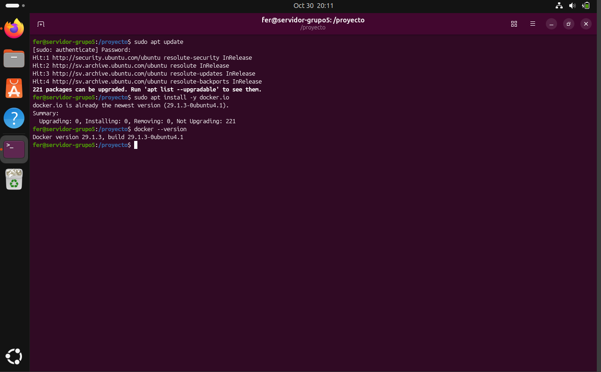
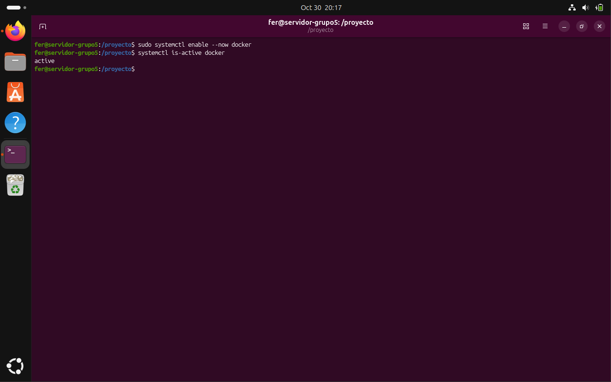

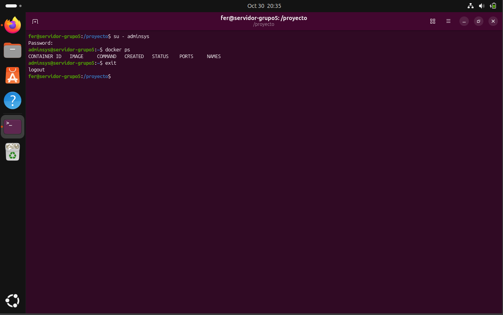

### 4.2 Verificación inicial

Se ejecutó el contenedor de prueba `hello-world` para confirmar que Docker descarga imágenes y ejecuta contenedores, y se listaron todos los contenedores.

```bash
docker run hello-world
docker ps -a
```

El contenedor `hello-world` aparece con estado `Exited (0)`, que es lo esperado.

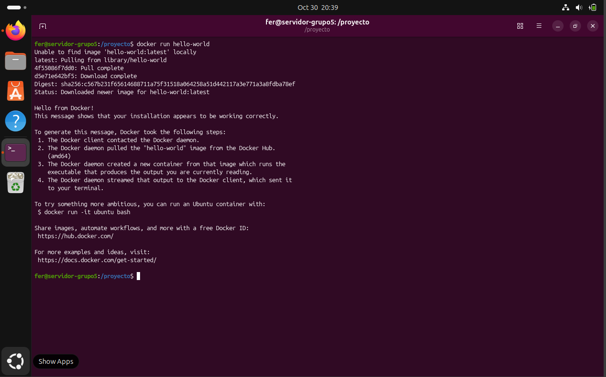


## Sección 5: Servidor web containerizado

### 5.1 Contenedor Nginx básico

Se creó `/proyecto/web/index.html` con el título del proyecto y los integrantes del Grupo 5, se le dieron permisos de lectura y se levantó un contenedor Nginx en segundo plano. El contenedor mapea el puerto 8080 del host al 80 del contenedor y monta `/proyecto/web` en `/usr/share/nginx/html`.

```bash
nano /proyecto/web/index.html
chmod 644 /proyecto/web/index.html
docker run -d --name nginx-basico -p 8080:80 -v /proyecto/web:/usr/share/nginx/html nginx
docker ps
```

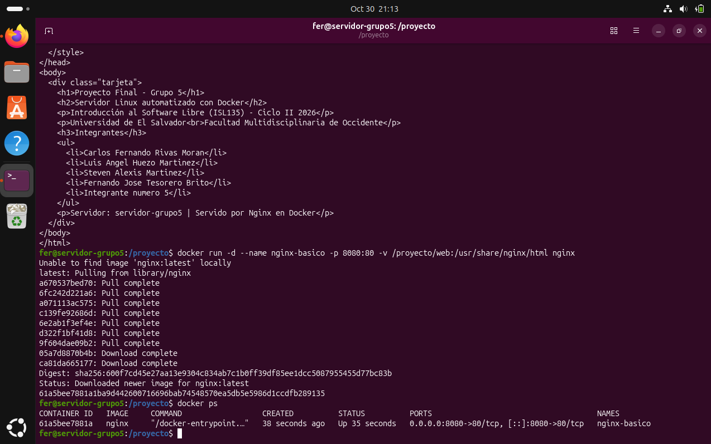

### 5.2 Verificación del servicio web

Se comprobó el servicio con `curl`, se revisaron los logs del contenedor (sin errores, solo mensajes `[notice]` y una petición `GET / 200`) y se abrió la página en el navegador.

```bash
curl http://localhost:8080
docker logs nginx-basico
```

Navegador: `http://localhost:8080`

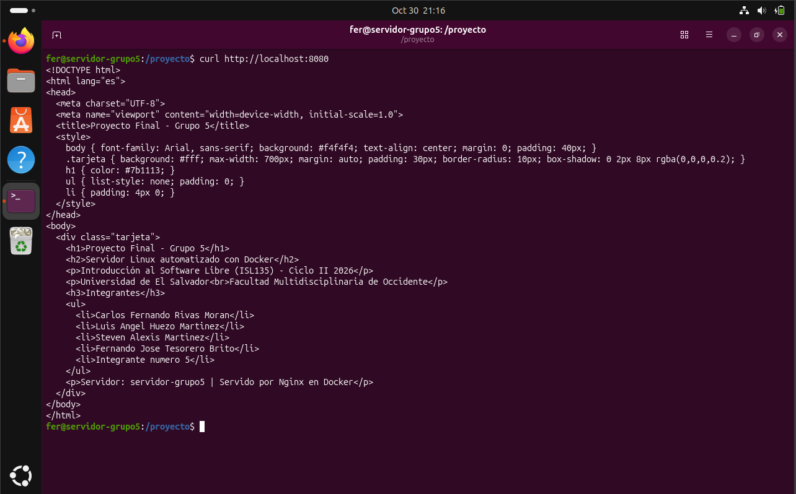
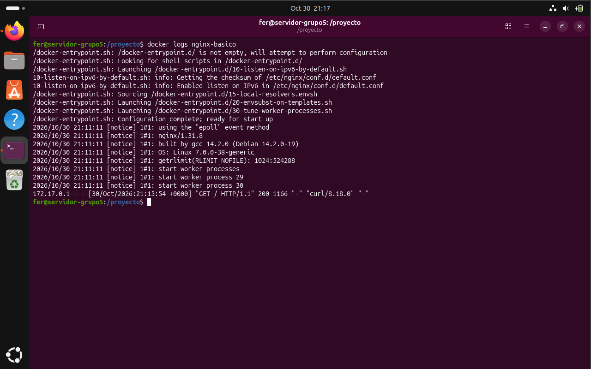
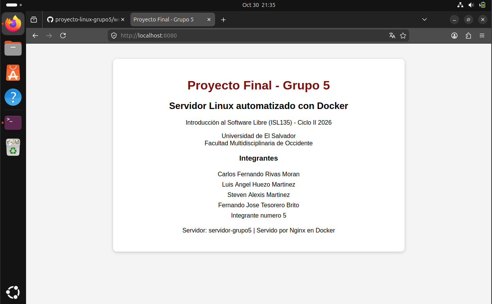

## Sección 6: Docker avanzado

> Requisitos previos: Docker instalado (sección 4) y `web/index.html` creado (sección 5). El `Dockerfile` copia el contenido de `web/` dentro de la imagen, así que el `index.html` debe estar terminado antes de construirla.

### 6.1 Dockerfile personalizado

Se creó `/proyecto/Dockerfile` con la imagen base `nginx:latest`, que copia el contenido de `web/` al directorio de Nginx, expone el puerto 80 y define el comando de inicio.

```dockerfile
FROM nginx:latest
COPY web/ /usr/share/nginx/html/
EXPOSE 80
CMD ["nginx", "-g", "daemon off;"]
```

Luego se construyó la imagen `servidor-grupo5` desde `/proyecto` (el punto final indica el contexto de construcción) y se comprobó que existe:

```bash
cd /proyecto
cat Dockerfile
docker build -t servidor-grupo5 .
docker images
```

Al construir aparece el aviso `DEPRECATED: The legacy builder...`. Es solo informativo y no afecta el resultado.

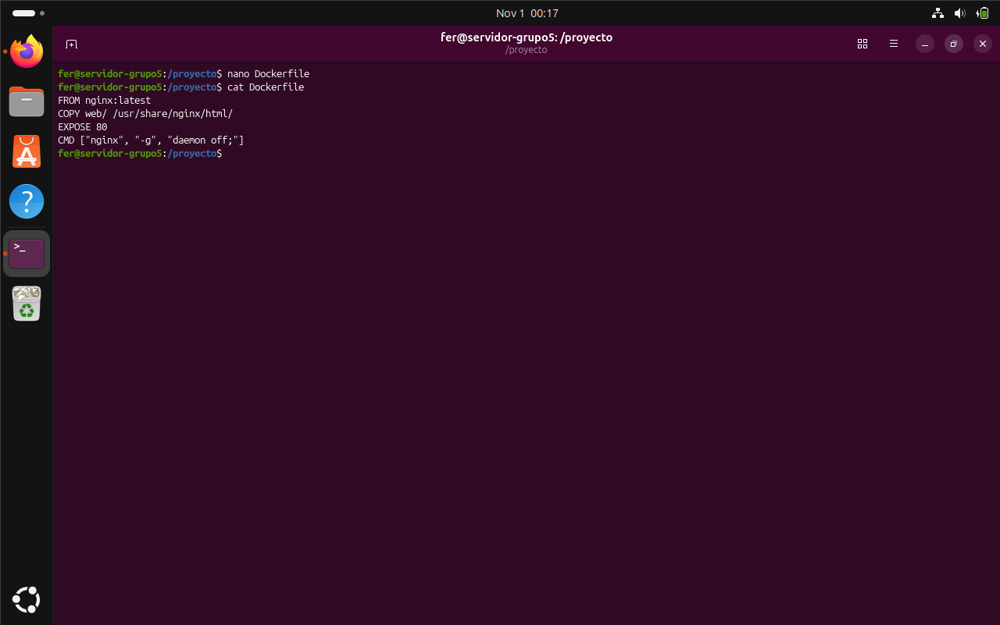
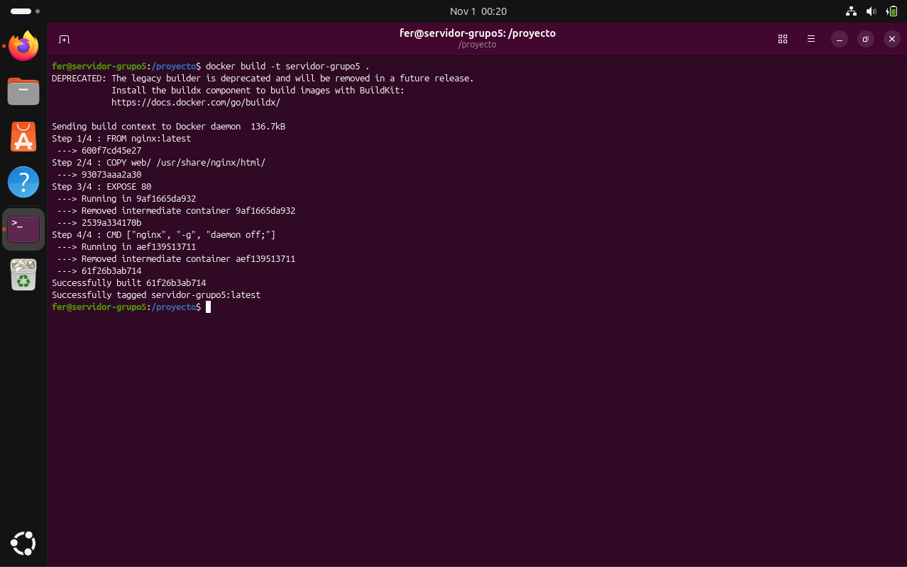
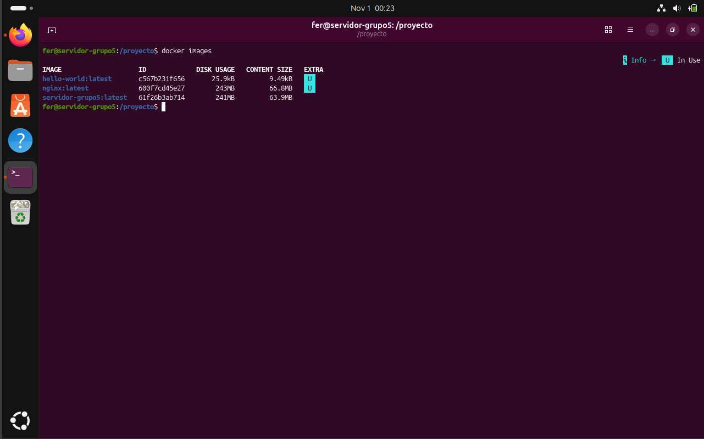

### 6.2 Contenedor con la imagen personalizada

Se ejecutó un contenedor en segundo plano con la imagen `servidor-grupo5`, mapeando el puerto 8081 del host al 80 del contenedor, y se verificó con `curl` y con el navegador en `http://localhost:8081`.

```bash
docker run -d --name servidor-grupo5 -p 8081:80 servidor-grupo5
docker ps
curl http://localhost:8081
```

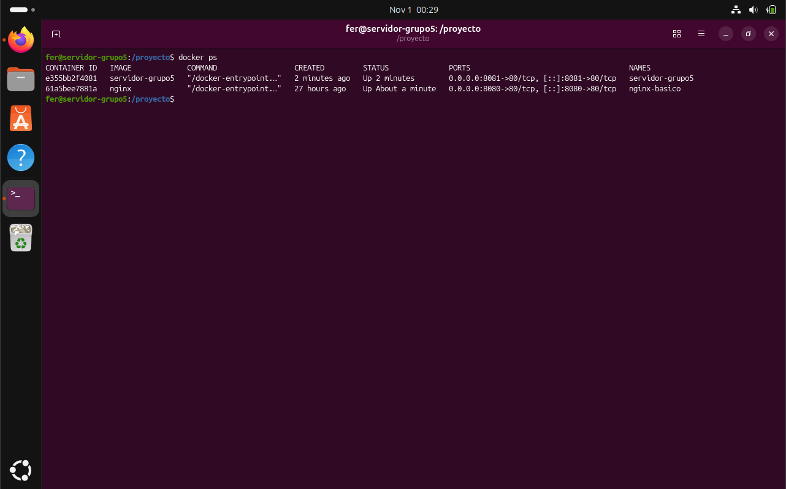
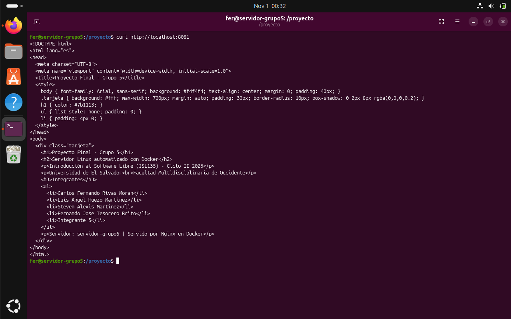
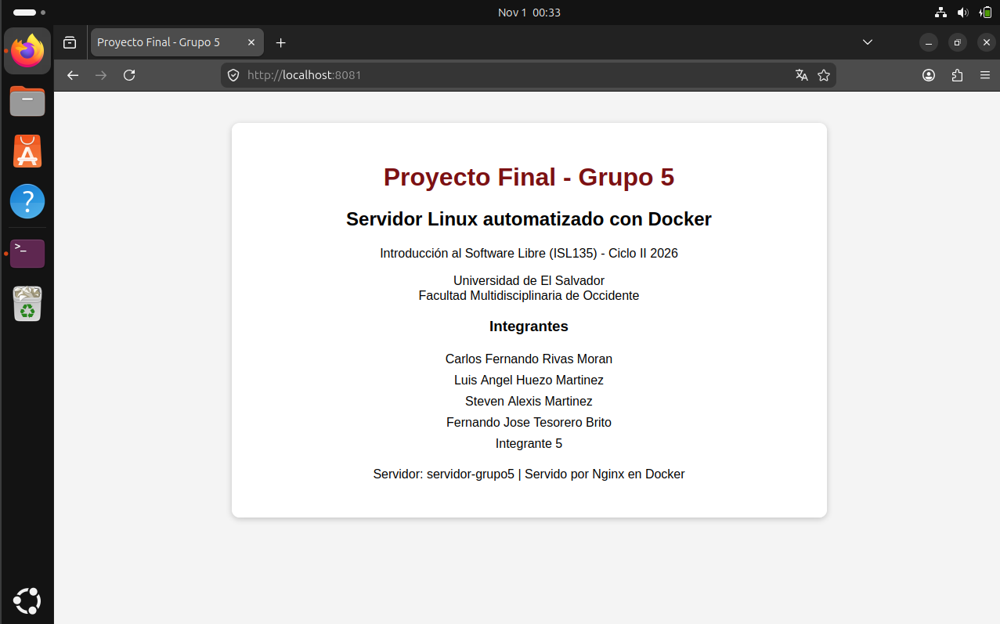

### Comparación con el Nginx oficial

`nginx-basico` (puerto 8080) **monta** la carpeta `/proyecto/web`, así que ve los cambios del archivo al instante. `servidor-grupo5` (puerto 8081) tiene los archivos **copiados dentro de la imagen**, así que no cambia hasta reconstruirla. Se comprobó con un cambio temporal en `index.html`:

```bash
sed -i 's/Servido por Nginx en Docker/Servido por Nginx en Docker - CAMBIO DE PRUEBA/' /proyecto/web/index.html
curl -s http://localhost:8080 | grep "CAMBIO"
curl -s http://localhost:8081 | grep "CAMBIO"
```

El puerto 8080 muestra la línea con `CAMBIO DE PRUEBA` y el 8081 no muestra nada. Después se revirtió el cambio:

```bash
sed -i 's/ - CAMBIO DE PRUEBA//' /proyecto/web/index.html
chmod 644 /proyecto/web/index.html
```

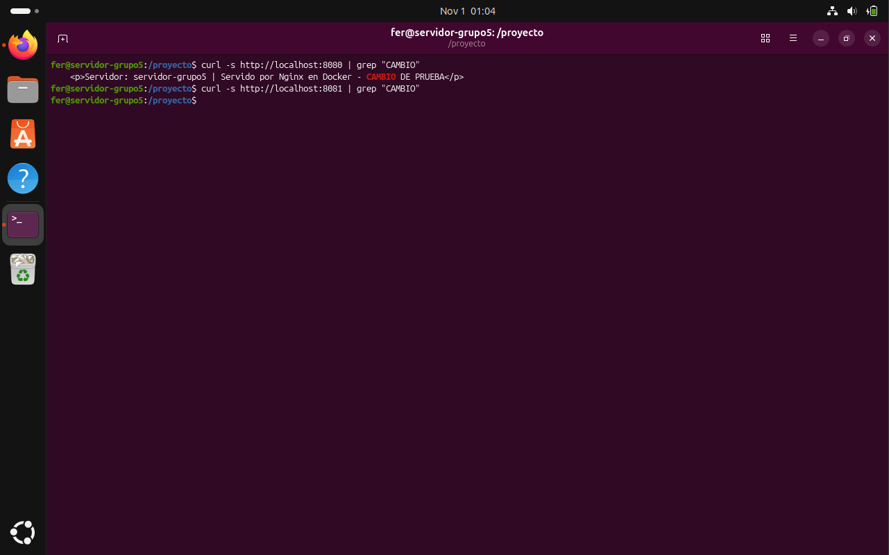

| | `nginx-basico` | `servidor-grupo5` |
|---|---|---|
| Puerto | 8080 | 8081 |
| Contenido | Montado con `-v` desde `/proyecto/web` | Copiado en la imagen con `COPY` |
| Cambios en `index.html` | Se ven al instante | Requieren reconstruir la imagen |

## Sección 7: Redes y volúmenes Docker

> Requisito previo: Docker instalado (sección 4). Esta sección usa la imagen oficial `nginx`, así que no depende del `index.html` ni del `Dockerfile`.

### 7.1 Red personalizada

Se creó la red `red-proyecto` y se levantó un contenedor Nginx conectado a ella, con el puerto 8082 del host mapeado al 80 del contenedor.

```bash
docker network create red-proyecto
docker network ls
docker run -d --name nginx-red --network red-proyecto -p 8082:80 nginx
docker ps
docker network inspect red-proyecto
curl http://localhost:8082
```

En la salida de `docker network inspect`, dentro de `"Containers"`, aparece `nginx-red` con su IP en la subred de `red-proyecto`. El `curl` devuelve la página por defecto de Nginx (`Welcome to nginx!`), porque este contenedor no monta la carpeta `web/`.

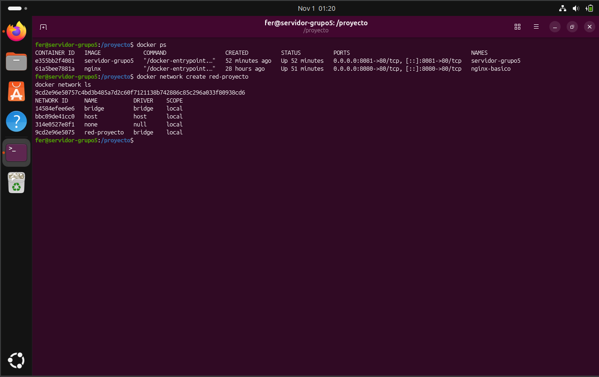
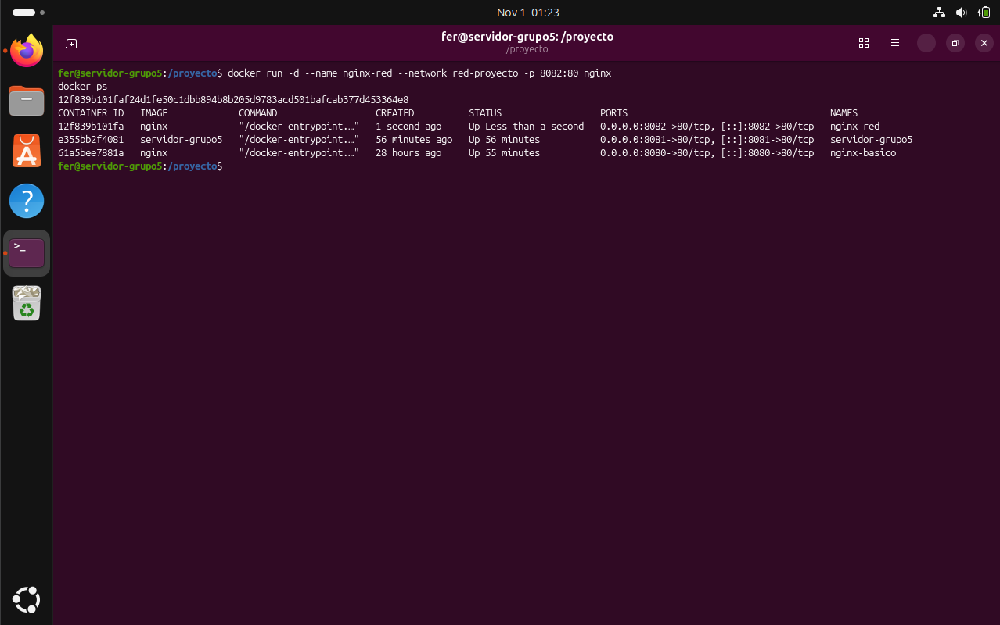
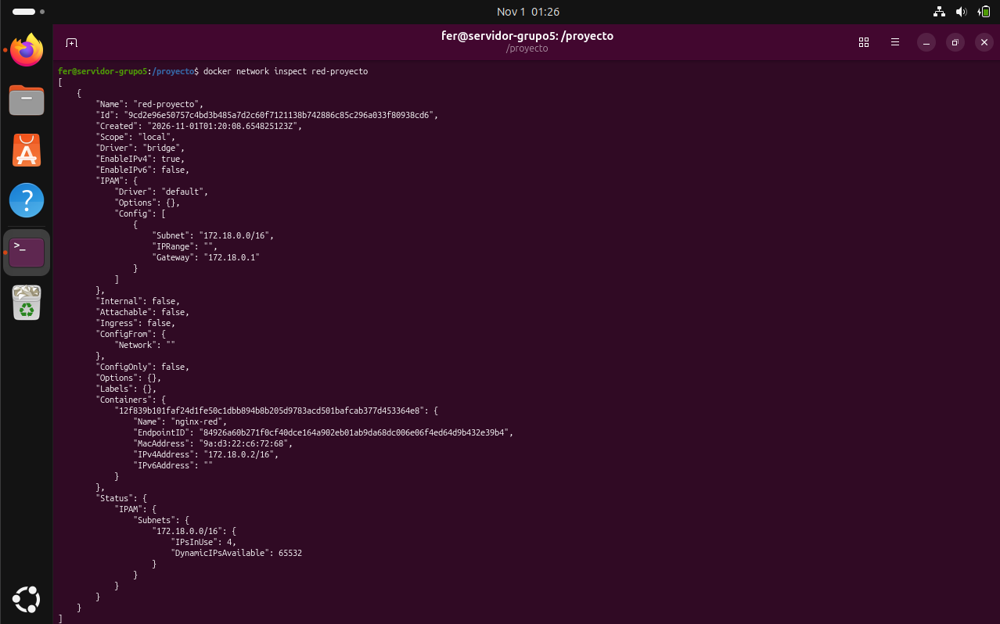
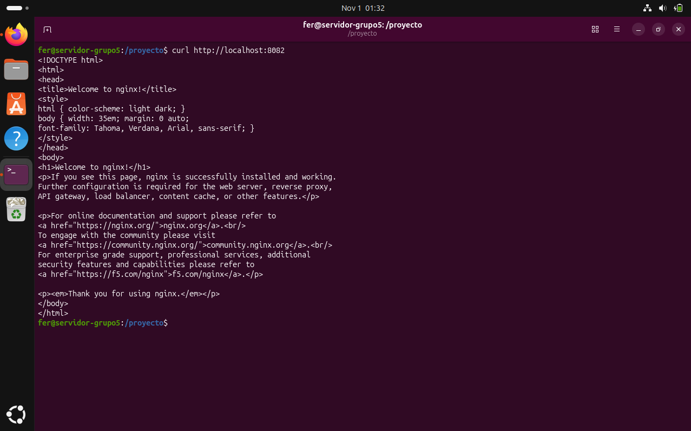

### 7.2 Volumen persistente

Se creó el volumen `volumen-web` y se levantó un contenedor Nginx que lo monta en el directorio de contenido web, con el puerto 8083 del host mapeado al 80 del contenedor.

```bash
docker volume create volumen-web
docker volume ls
docker run -d --name nginx-volumen -p 8083:80 -v volumen-web:/usr/share/nginx/html nginx
docker ps
docker volume inspect volumen-web
docker inspect nginx-volumen | grep -A 12 '"Mounts"'
curl http://localhost:8083
```

El nombre del volumen lleva guion (`volumen-web`). Si se escribe distinto, Docker crea otro volumen sin avisar. En la sección `"Mounts"` del contenedor aparece `"Type": "volume"`, `"Name": "volumen-web"` y `"Destination": "/usr/share/nginx/html"`.

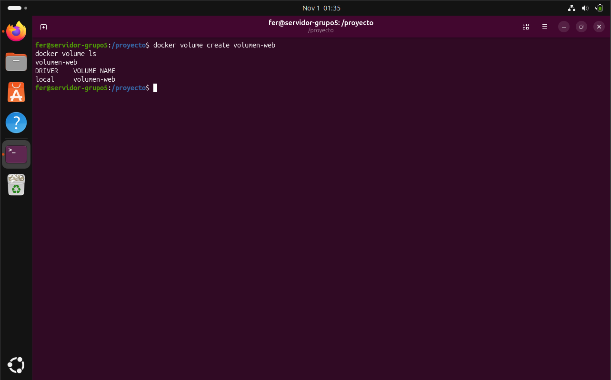
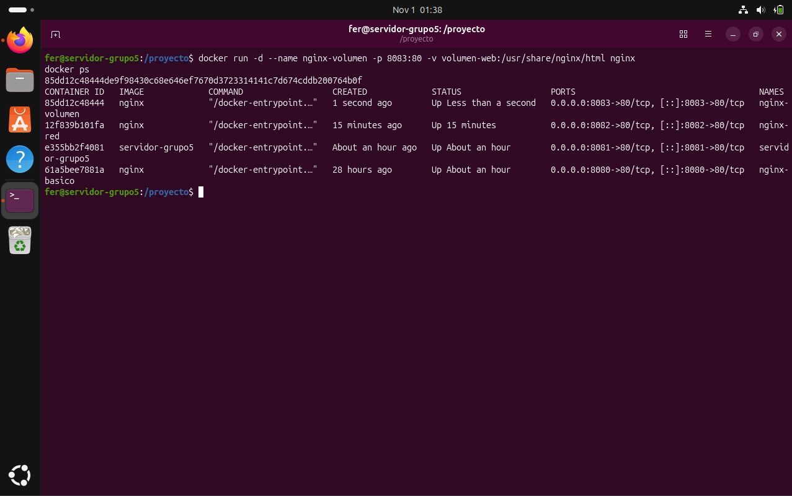
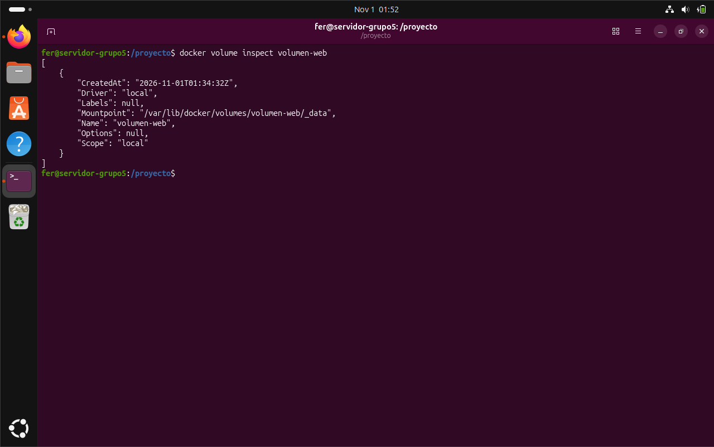
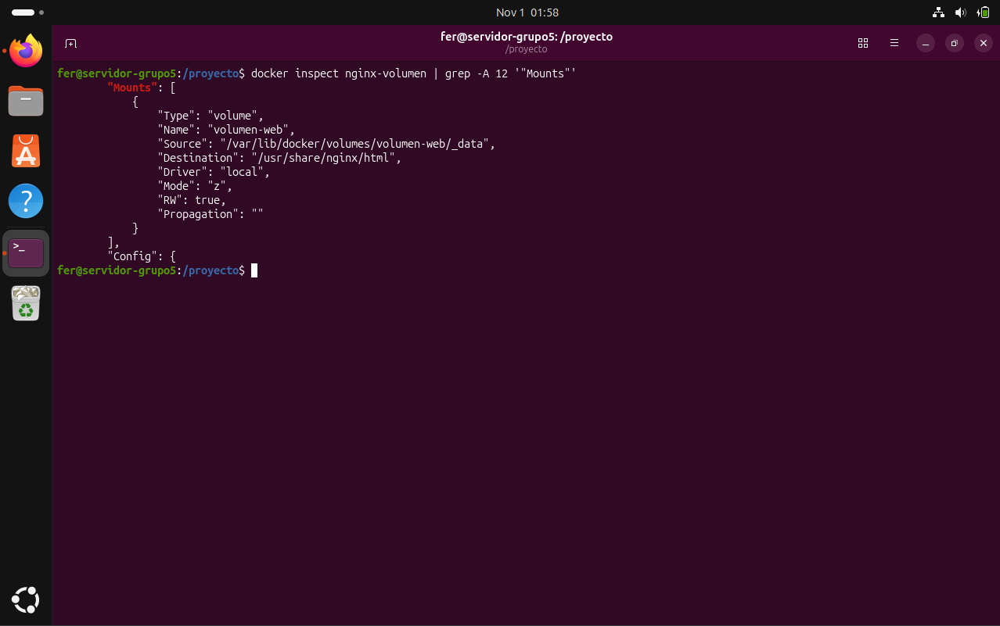
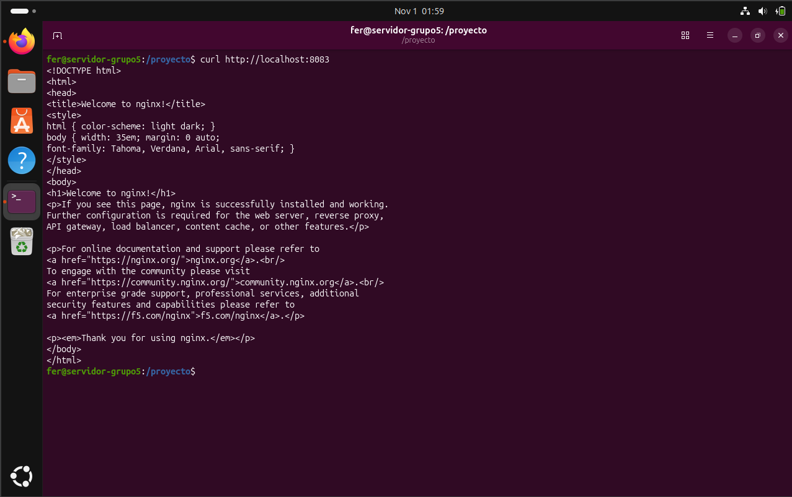

### Prueba de persistencia

Se escribió un contenido propio dentro del volumen, se borró el contenedor y se creó de nuevo con el mismo volumen. El contenido siguió ahí, porque los datos viven en el volumen y no en el contenedor.

```bash
docker exec nginx-volumen sh -c 'echo "<h1>Persistencia Grupo 5</h1>" > /usr/share/nginx/html/index.html'
curl http://localhost:8083
docker rm -f nginx-volumen
docker run -d --name nginx-volumen -p 8083:80 -v volumen-web:/usr/share/nginx/html nginx
curl http://localhost:8083
```

Ambos `curl` devuelven `<h1>Persistencia Grupo 5</h1>`.

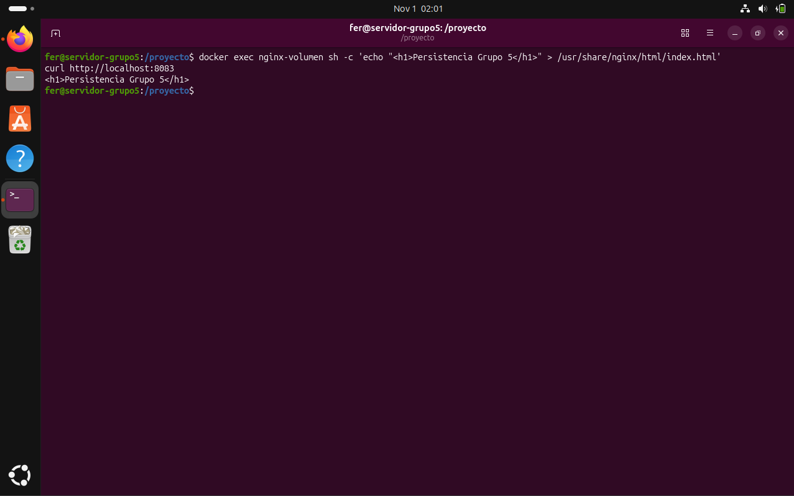
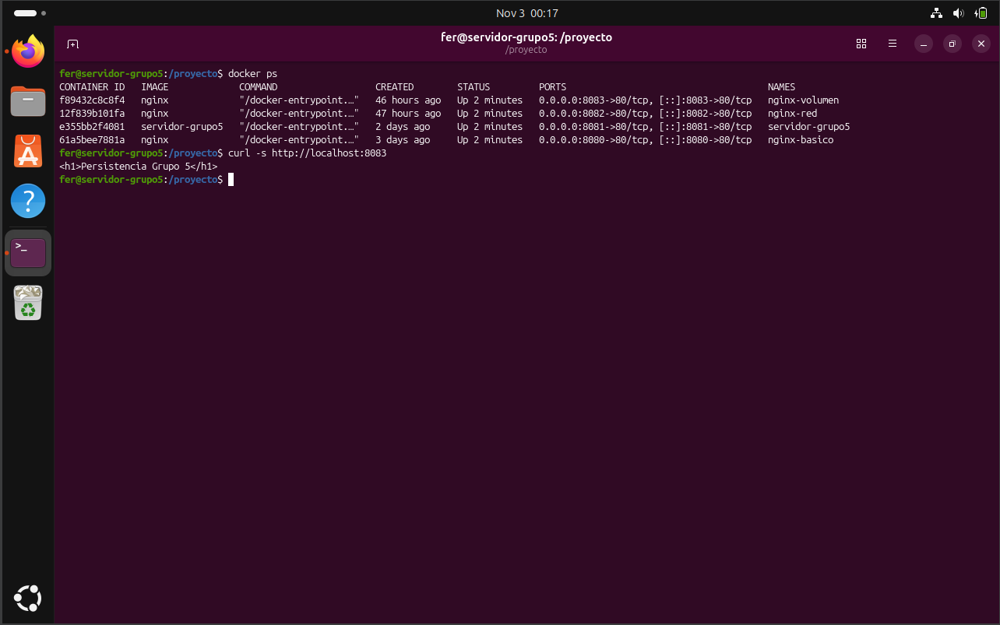

> Nota: el script `scripts/07_redes_volumenes.sh`, del Integrante de la sección 7, automatiza estos mismos pasos (misma red, mismo volumen, mismos contenedores y puertos). Además agrega `--restart unless-stopped` a los contenedores y guarda su página de prueba en `volumen.html`. Las capturas de esta sección se tomaron en la VM del Integrante Fernando, ejecutando los comandos a mano.


## Sección 8: Pruebas y verificación final

> Requisitos previos: los cuatro contenedores de las secciones 5, 6 y 7 en ejecución (`nginx-basico`, `servidor-grupo5`, `nginx-red` y `nginx-volumen`), la red `red-proyecto` y el cron de la sección 2. Si se reinició la VM, los contenedores no arrancan solos: `docker start nginx-basico servidor-grupo5 nginx-red nginx-volumen`.

### 8.1 Pruebas de conectividad

Se ejecutó un contenedor Alpine conectado a `red-proyecto` y se hizo `ping` al contenedor `nginx-red` por su nombre. En una red personalizada Docker resuelve los nombres de los contenedores, cosa que la red `bridge` por defecto no hace. La opción `--rm` borra el contenedor de prueba al terminar.

```bash
docker run -it --rm --name alpine-test --network red-proyecto alpine ping -c 4 nginx-red
```

El `ping` resuelve `nginx-red` a su IP dentro de la red (la misma que muestra `docker network inspect red-proyecto`) y termina con `0% packet loss`.

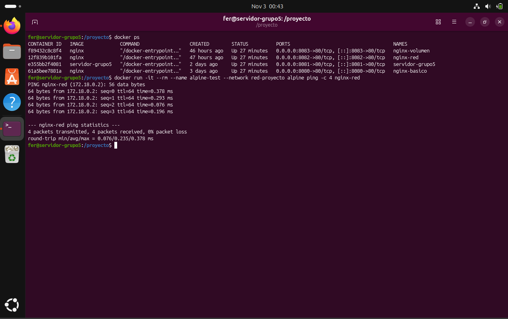

### 8.2 Verificación integral

**Servicios web.** Se consultaron los cuatro puertos y todos responden `HTTP/1.1 200 OK`:

```bash
curl -I http://localhost:8080
curl -I http://localhost:8081
curl -I http://localhost:8082
curl -I http://localhost:8083
```

| Puerto | Contenedor | Contenido |
|---|---|---|
| 8080 | `nginx-basico` | `index.html` del Grupo 5 (carpeta montada) |
| 8081 | `servidor-grupo5` | `index.html` del Grupo 5 (copiado en la imagen) |
| 8082 | `nginx-red` | Página por defecto de Nginx |
| 8083 | `nginx-volumen` | Contenido guardado en `volumen-web` |

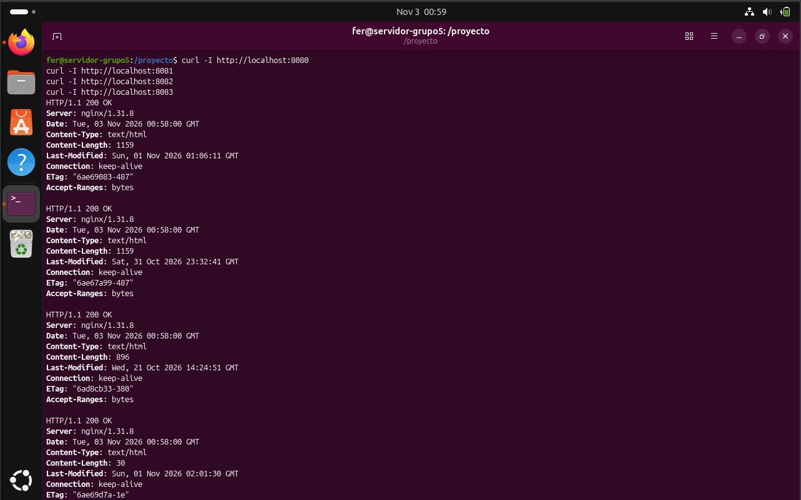

**Contenedores en ejecución.** Deben aparecer los cuatro en estado `Up`:

```bash
docker ps
```

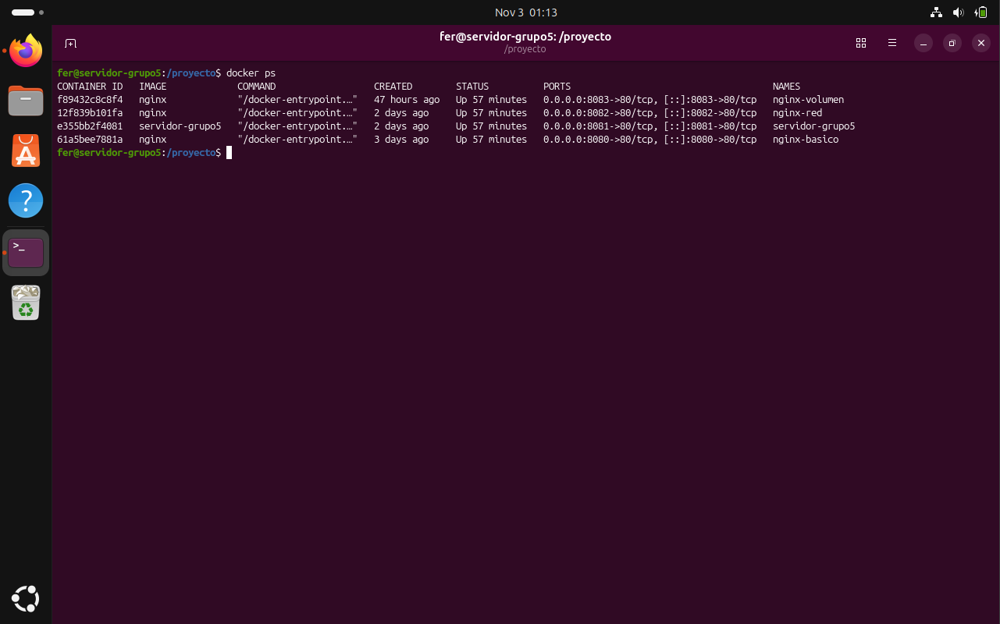

**Script de monitoreo con cron.** Se comprobó que el servicio cron está activo, que la tarea cada 30 minutos está configurada y que el log recibe entradas automáticas, no solo la manual del script de instalación:

```bash
systemctl is-active cron
sudo crontab -l
date
tail -n 20 /var/log/proyecto/reporte_sistema.log
sudo journalctl -u cron --since '1 hour ago'
```

El log muestra una entrada nueva en el minuto `:00` o `:30` que sigue a la configuración, y `journalctl` registra la ejecución de `reporte_sistema.sh` por cron.

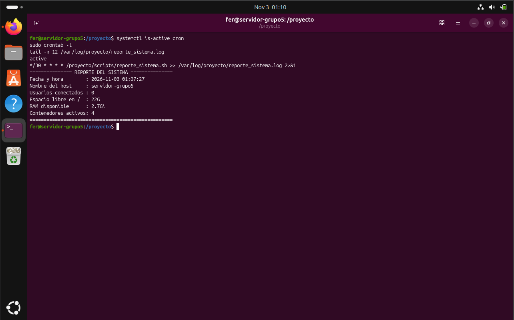
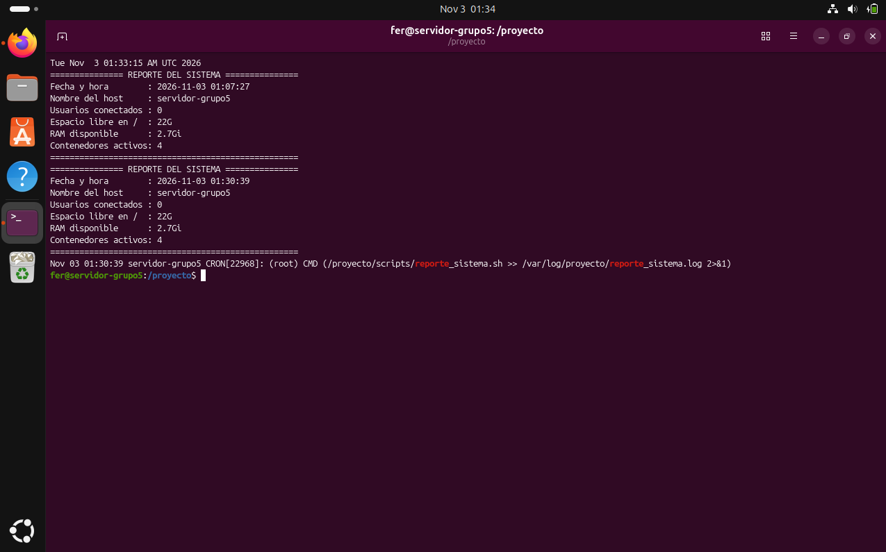
